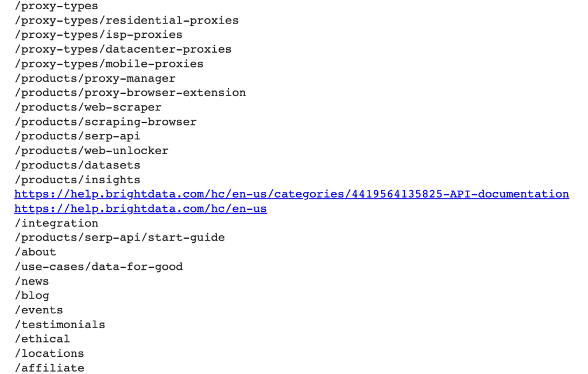
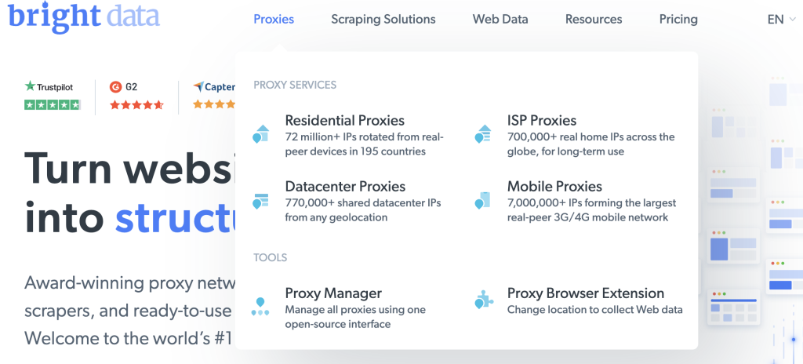
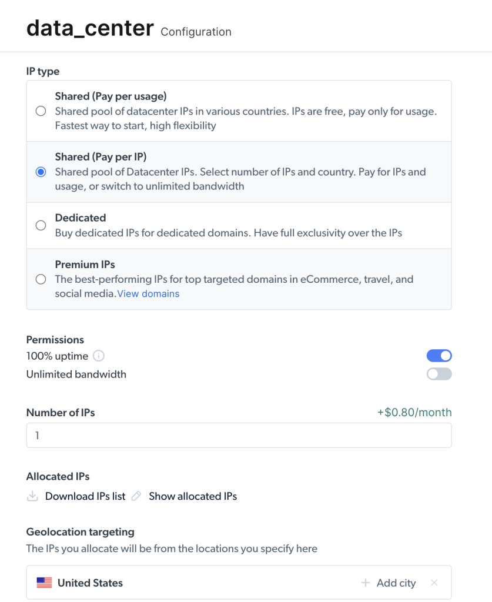
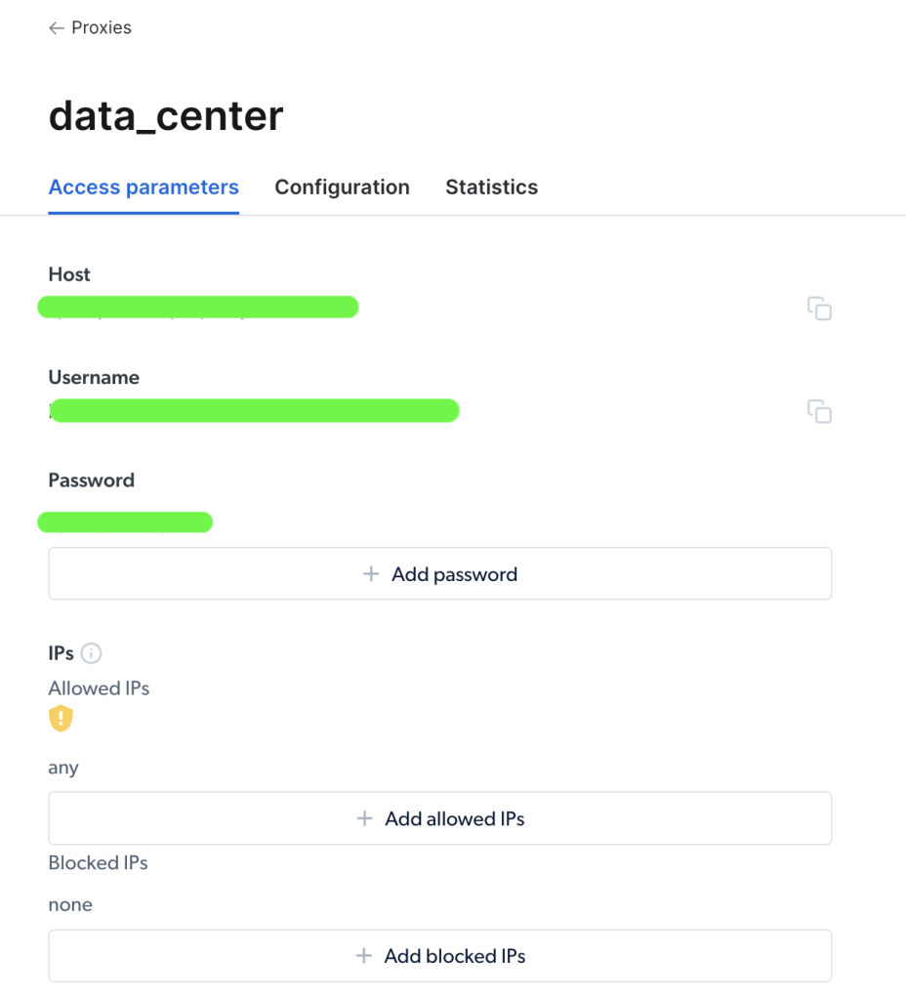

# 在 Python Requests 中使用代理


[](https://www.bright.cn/proxy-types/residential-proxies) 

本指南将介绍如何在 Python requests 中使用代理，尤其是用于[网页爬虫](https://www.bright.cn/blog/how-tos/what-is-web-scraping)，通过更改 IP 和位置来[绕过网站限制](https://brightdata.com/blog/proxy-101/how-to-bypass-an-ip-ban)：

- [在 Python 请求中使用代理](#在-python-请求中使用代理)
- [安装软件包](#安装软件包)
- [代理 IP 地址的组成部分](#代理-ip-地址的组成部分)
- [直接在 Requests 中设置代理](#直接在-requests-中设置代理)
- [通过环境变量设置代理](#通过环境变量设置代理)
- [使用自定义方法和代理数组轮换代理](#使用自定义方法和代理数组轮换代理)
- [通过 Python 使用 Bright Data 代理服务](#通过-python-使用-bright-data-代理服务)
- [总结](#总结)

## 在 Python 请求中使用代理

## 安装软件包

使用 `pip install` 安装以下 Python 软件包，以便向网页发送请求并采集链接：

- `requests`：向你想要抓取数据的网站发送 HTTP 请求。
- `beautifulsoup4`：解析 HTML 和 XML 文档以提取所有链接。

## 代理 IP 地址的组成部分

代理服务器主要由三个部分组成：

1.  **协议**通常为 HTTP 或 HTTPS。
2.  **地址**可以是 IP 地址或 DNS 主机名。
3.  **端口号**范围为 0 到 65535，例如 `2000`。

因此，代理 IP 地址的格式如下：`https://192.167.0.1:2000` 或 `https://proxyprovider.com:2000`。

## 直接在 Requests 中设置代理

本指南介绍三种在请求中设置代理的方法。第一种方法是在 requests 模块中直接设置代理。

请按以下步骤操作：

1. 在 Python 脚本中导入 Requests 和 Beautiful Soup 软件包。
2. 创建一个名为 `proxies` 的字典，用于存放代理服务器信息。
3. 在 `proxies` 字典中，为代理 URL 定义 HTTP 和 HTTPS 连接。
4. 定义一个 Python 变量，用于设置你想从中抓取数据的网页 URL。使用 `https://www.bright.cn/`。
5. 使用 `request.get()` 方法向网页发送 GET 请求，该方法接受两个参数：网站 URL 和代理。响应将存储在 `response` 变量中。
6. 将 `response.content` 和 `html.parser` 作为参数传递给 `BeautifulSoup()` 方法，以采集链接。
7. 使用 `find_all()` 方法并将 `a` 作为参数，查找网页上的所有链接。
8. 使用 `get()` 方法提取每个链接的 `href` 属性。

以下是完整源代码：

```
# import packages.  
import requests  
from bs4 import BeautifulSoup  
  
# Define proxies to use.  
proxies = {  
    'http': 'http://proxyprovider.com:2000',  
    'https': 'https://proxyprovider.com:2000',  
}  
  
# Define a link to the web page.  
url = "https://example.com/"   
  
# Send a GET request to the website.  
response = requests.get(url, proxies=proxies)  
  
# Use BeautifulSoup to parse the HTML content of the website.  
soup = BeautifulSoup(response.content, "html.parser")  
  
# Find all the links on the website.  
links = soup.find_all("a")  
  
# Print all the links.  
for link in links:  
    print(link.get("href"))
```

以下是运行上述脚本后的输出：



## 通过环境变量设置代理

要为所有请求使用同一个代理，最好在终端窗口中设置环境变量：

```powershell
export HTTP_PROXY='http://proxyprovider.com:2000'  
export HTTPS_PROXY='https://proxyprovider.com:2000'
```

现在可以从脚本中删除代理定义：

```
# import packages.  
import requests  
from bs4 import BeautifulSoup  
  
# Define a link to the web page.  
url = "https://example.com/"   
  
# Send a GET request to the website.  
response = requests.get(url)  
  
# Use BeautifulSoup to parse the HTML content of the website.  
soup = BeautifulSoup(response.content, "html.parser")  
  
# Find all the links on the website.  
links = soup.find_all("a")  
  
# Print all the links.  
for link in links:  
    print(link.get("href"))
```

## 使用自定义方法和代理数组轮换代理

[](https://www.bright.cn/proxy-types/residential-proxies) 

轮换代理有助于绕过网站在收到来自同一 IP 地址的大量请求时施加的限制。

请按以下步骤操作：

1. 导入以下 Python 库：Requests、Beautiful Soup 和 Random。
2. 创建一个代理列表，供轮换过程中使用。使用 `http://proxyserver.com:port` 格式：

```
# List of proxies  
proxies = [  
    "http://proxyprovider1.com:2010", "http://proxyprovider1.com:2020",  
    "http://proxyprovider1.com:2030", "http://proxyprovider2.com:2040",  
    "http://proxyprovider2.com:2050", "http://proxyprovider2.com:2060",  
    "http://proxyprovider3.com:2070", "http://proxyprovider3.com:2080",  
    "http://proxyprovider3.com:2090"  
]
```

3. 创建一个名为 `get_proxy()` 的自定义方法。它将使用 `random.choice()` 方法从代理列表中随机选择一个代理，并以字典格式返回所选代理（同时包含 HTTP 和 HTTPS 键）。每次发送新请求时都将使用此方法：

```
# Custom method to rotate proxies  
def get_proxy():  
    # Choose a random proxy from the list  
    proxy = random.choice(proxies)  
    # Return a dictionary with the proxy for both http and https protocols  
    return {'http': proxy, 'https': proxy}  
```

4. 创建一个循环，使用轮换代理发送指定数量的 GET 请求。在每个请求中，`get()` 方法都会使用由 `get_proxy()` 方法随机选择的代理。

5. 按照前面介绍的方法，使用 Beautiful Soup 软件包从网页的 HTML 内容中采集链接。

6. 捕获并输出请求过程中发生的所有异常。

以下是此示例的完整源代码：

```
# import packages  
import requests  
from bs4 import BeautifulSoup  
import random  
  
# List of proxies  
proxies = [  
    "http://proxyprovider1.com:2010", "http://proxyprovider1.com:2020",  
    "http://proxyprovider1.com:2030", "http://proxyprovider2.com:2040",  
    "http://proxyprovider2.com:2050", "http://proxyprovider2.com:2060",  
    "http://proxyprovider3.com:2070", "http://proxyprovider3.com:2080",  
    "http://proxyprovider3.com:2090"  
]

# Custom method to rotate proxies  
def get_proxy():  
    # Choose a random proxy from the list  
    proxy = random.choice(proxies)  
    # Return a dictionary with the proxy for both http and https protocols  
    return {'http': proxy, 'https': proxy}  
  
  
# Send requests using rotated proxies  
for i in range(10):  
    # Set the URL to scrape  
    url = 'https://brightdata.com/'  
    try:  
        # Send a GET request with a randomly chosen proxy  
        response = requests.get(url, proxies=get_proxy())  
  
        # Use BeautifulSoup to parse the HTML content of the website.  
        soup = BeautifulSoup(response.content, "html.parser")  
  
        # Find all the links on the website.  
        links = soup.find_all("a")  
  
        # Print all the links.  
        for link in links:  
            print(link.get("href"))  
    except requests.exceptions.RequestException as e:  
        # Handle any exceptions that may occur during the request  
        print(e)
```

## 通过 Python 使用 Bright Data 代理服务

Bright Data 拥有一个庞大的代理网络，其中包括超过 7200 万个[住宅代理 IP](https://www.bright.cn/proxy-types/residential-proxies)和超过 77 万个[数据中心代理](https://www.bright.cn/proxy-types/datacenter-proxies)。

你可以将 [Bright Data 的数据中心代理](https://www.bright.cn/integration)集成到 Python 请求中。注册 Bright Data 账户后，请按照以下步骤创建你的第一个代理：

1. 在欢迎页面上点击 **查看代理产品**，查看 Bright Data 提供的不同代理类型：



2. 选择 **数据中心代理** 以创建新代理，然后在下一页添加你的详细信息并保存：



3. 创建代理后，控制面板将显示可在脚本中使用的主机、端口、用户名和密码等参数：



4. 将这些参数复制并粘贴到脚本中，并使用以下代理 URL 格式：`username-(session-id)-password@host:port`。

> **注意：**\
> `session-id` 是使用名为 `random` 的 Python 软件包创建的随机数。

以下代码在 Python 请求中使用 Bright Data 的代理：

```
import requests  
from bs4 import BeautifulSoup  
import random  
  
# Define parameters provided by Brightdata  
host = 'brd.superproxy.io'  
port = 33335  
username = 'username'  
password = 'password'  
session_id = random.random()  
  
# format your proxy  
proxy_url = ('http://{}-session-{}:{}@{}:{}'.format(username, session_id,  
                                                     password, host, port))  
  
# define your proxies in dictionary  
proxies = {'http': proxy_url, 'https': proxy_url}  
  
# Send a GET request to the website  
url = "https://example.com/"   
response = requests.get(url, proxies=proxies)  
  
# Use BeautifulSoup to parse the HTML content of the website  
soup = BeautifulSoup(response.content, "html.parser")  
  
# Find all the links on the website  
links = soup.find_all("a")  
  
# Print all the links  
for link in links:  
    print(link.get("href"))
```

运行此代码将通过 Bright Data 的[代理服务](https://www.bright.cn/proxy-types)成功发送请求。

## 总结

借助 Bright Data 的网页平台，你可以为项目获取覆盖全球任意国家或城市的可靠代理。立即免费试用 Bright Data 的[代理服务](https://www.bright.cn/proxy-types)！
